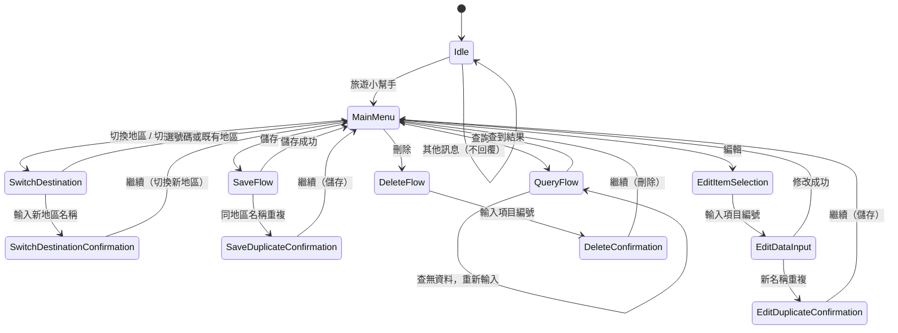
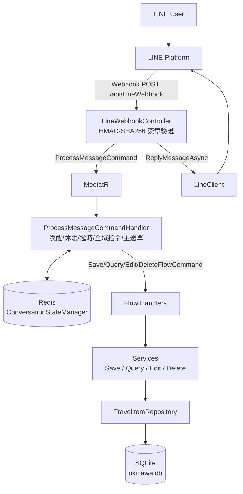

# Okinawa Travel Knowledge Bot — 系統設計文件

> 本文件以**目前程式碼**為準。SRS 撰寫原則：
> FR = 系統要做什麼　BR = 系統有哪些規則　AC = 怎樣才算完成

## 1. 對話狀態機

`ConversationState` 共 12 種狀態（`Application/States/ConversationState.cs`）。



### 全域指令（在非 Idle 狀態皆優先攔截）

| 指令 | 行為 |
|------|------|
| `返回主選單` | `ResetToMainMenu`（清除 CurrentItemId / PendingSave / PendingEdit / PendingDestination，保留目的地）→ `MainMenu`，並重新顯示喚醒提示 |
| `再見小幫手` | `Reset` → `Idle`，回覆「已退出小幫手。若要再次使用，請輸入「旅遊小幫手」。」（`BotMessages.SleepNotice`） |

### 逾時與連續操作

- 流程完成後（儲存／編輯／刪除成功、查詢出結果）狀態回到 `MainMenu`（連續操作模式），回覆訊息附帶主選單提示，使用者不需重新輸入「旅遊小幫手」即可繼續操作。
- 非 `Idle` 狀態超過 **10 分鐘**（`FlowTimeout`）未活動，下一則訊息先重置流程：
  - 訊息為 `旅遊小幫手`：直接回主選單（保留目的地）。
  - 其他訊息：回覆「先前的操作已逾時並已重置，請輸入「旅遊小幫手」開始。」
- Redis 快取為 **1 天**滑動過期（目的地偏好長效保留）。

## 2. 系統架構



## 3. 專案結構

```
OkinawaBot/
├── src/OkinawaBot/
│   ├── Controllers/
│   │   └── LineWebhookController.cs
│   ├── Application/
│   │   ├── Commands/        BotCommand, BotCommandParser
│   │   ├── Requests/        ProcessMessageCommand, Save/Query/Edit/DeleteFlowCommand
│   │   ├── Handlers/        ProcessMessageCommandHandler
│   │   ├── Flows/           Save/Query/Edit/DeleteFlowHandler
│   │   ├── Input/           SaveInputParser, EditInputParser
│   │   ├── Services/        Save/Query/Edit/DeleteService
│   │   ├── Models/          BotResponse, BotMessages, SaveResult, EditResult, 各種 Request/ParseResult DTO
│   │   └── States/          ConversationState, ConversationContext, ConversationStateManager
│   ├── Domain/
│   │   ├── Entities/        TravelItem
│   │   └── Interfaces/      ITravelItemRepository
│   ├── Infrastructure/
│   │   ├── Data/            AppDbContext
│   │   ├── Repositories/    TravelItemRepository
│   │   └── Line/            ILineClient, LineClient, LineSignatureValidator,
│   │                        LineBotOptions, LineWebhookRequest
│   ├── Migrations/
│   └── Program.cs
├── tests/OkinawaBot.Tests/
├── docs/                    SRS.md, design.md, DEVLOG.md
├── .github/workflows/       dotnet.yml (GitHub Actions CI)
├── docker-compose.yml       okinawabot + redis
├── Dockerfile
├── OkinawaBot.sln
└── README.md
```

## 4. 指令與輸入格式

| 狀態 | 輸入 |
|------|------|
| Idle | `旅遊小幫手` 喚醒 |
| MainMenu | `儲存` / `查詢` / `編輯` / `刪除` / `切換地區`（或 `切換目的地`） |
| SaveFlow | `URL #類別 名稱`（單行或多行；`#類別` 前為 URL、後為名稱；URL 必須以 http:// 或 https:// 開頭） |
| QueryFlow | 類別名稱（需與資料庫現有類別完全相符，限定目前地區） |
| EditItemSelection / DeleteFlow | 項目編號（進入流程時會動態列出目前地區的所有項目與 1-based 編號供選擇） |
| EditDataInput | 單項或多項：`URL`、`#類別`、`名稱`，或 `網址:` / `類別:` / `名稱:` 前綴（URL 必須以 http:// 或 https:// 開頭） |
| 各確認狀態 | `繼續` 或 `返回主選單` |

URL 驗證：Save 與 Edit 均已實作 URL 合法 Scheme (http/https) 格式驗證。

### 回覆訊息與下一步提示（`BotMessages`）

每則回覆都要讓使用者知道下一步該做什麼（SRS BR-036）。跨流程重複使用的文字集中在 `Application/Models/BotMessages.cs`；只在單一流程使用的文字（例如編輯修改說明、Parser 錯誤訊息）留在原處。

| 成員 | 用途 |
|------|------|
| `MainMenuPrompt` | 主選單指令提示 |
| `InvalidItemNumber` / `ItemNumberOutOfRange(max)` | 編輯／刪除選號錯誤，附「或輸入『返回主選單』」 |
| `ContinueOrReturnPrompt` | 確認狀態提示「請輸入 繼續 或 返回主選單。」 |
| `SleepNotice` | 退出小幫手，附重新喚醒方式 |
| `OperationNotSupported` | 無法處理的操作，附 `返回主選單` / `旅遊小幫手` |
| `WithMainMenu(msg)` | 流程完成：`msg` + 「已回到主選單。」+ 主選單提示 |
| `WithRetryHint(msg)` | 輸入錯誤留在原流程：`msg` + 「請重新輸入，或輸入『返回主選單』。」 |
| `NoItemsToProcess(action)` | 編輯／刪除時沒有資料，並回主選單 |

提取原則：同一段文字出現 2 處以上才放進 `BotMessages`。

## 5. SQLite 資料表

```
┌────────────────────────────────────────┐
│              travel_items              │
├────────────────────────────────────────┤
│ Id           INTEGER PK                │
│ Destination  TEXT NOT NULL  (預設 沖繩) │
│ Name         TEXT NOT NULL             │
│ Url          TEXT NOT NULL             │
│ Category     TEXT NOT NULL             │
│ CreatedAt    DATETIME                  │
│ UpdatedAt    DATETIME                  │
├────────────────────────────────────────┤
│ INDEX (Destination, Category)          │
│ INDEX (Destination, Name)              │
└────────────────────────────────────────┘
```

- 資料不綁定 LINE 使用者（所有使用者共用同一份資料）。
- 啟動時自動執行 `Database.Migrate()`。

## 6. 對話狀態（Redis）

`ConversationContext`（JSON 序列化，Key 為 LINE `userId`，InstanceName 前綴 `OkinawaBot_`）：

| 欄位 | 說明 |
|------|------|
| `UserId` | LINE userId |
| `State` | 目前 `ConversationState` |
| `CurrentDestination` | 目前地區，預設 `沖繩` |
| `CurrentItemId` | 編輯／刪除中的項目 Id |
| `PendingSave` | 等待重複名稱確認的儲存請求 |
| `PendingEdit` | 等待重複名稱確認的編輯請求 |
| `PendingDestination` | 等待新地區確認的地區名稱 |
| `LastActiveAt` | 最後活動時間（逾時判斷用） |