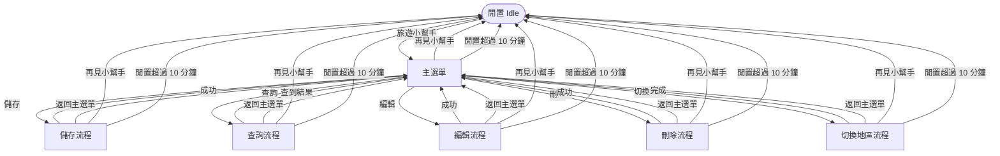

# Okinawa Travel Knowledge Bot — 使用流程

> 本文件說明使用者在 LINE 上如何操作小幫手。每個畫面的 **按鈕** 是 LINE 的 Quick Reply（SRS FR-020）：
> 點按鈕等同於自己輸入該文字，**也可以隨時手動打字**。

## 1. 總覽



- 流程完成後會自動回到主選單，**不需要重新喚醒**，可連續操作。
- 任何非閒置狀態輸入 `再見小幫手` 都會結束；`返回主選單` 可取消目前操作。
- 閒置超過 **10 分鐘**，下一則訊息會先重置流程（輸入 `旅遊小幫手` 可直接回主選單，目前地區保留）。

## 2. 各步驟與按鈕

| 步驟 | 使用者做什麼 | 機器人回覆 | 出現的按鈕 |
|------|--------------|------------|------------|
| 喚醒 | 輸入或點 `旅遊小幫手` | 歡迎訊息＋目前地區＋指令提示 | 儲存 / 查詢 / 編輯 / 刪除 / 切換地區 / 再見小幫手 |
| 儲存 | 點 `儲存` | 顯示輸入格式 | 返回主選單 / 再見小幫手 |
| 儲存 | 輸入 `URL #類別 名稱` | 儲存成功並回主選單 | 主選單按鈕 |
| 儲存（名稱重複） | 輸入同名項目 | 詢問是否仍要儲存 | 繼續 / 返回主選單 |
| 查詢 | 點 `查詢` | 列出目前地區已有的類別 | 各類別（最多 11 個）/ 返回主選單 |
| 查詢 | 點類別或輸入類別 | 列出該類別的名稱與網址，回主選單 | 主選單按鈕 |
| 編輯 | 點 `編輯` | 列出項目與編號 | 編號 1..N（項目 ≤ 11）/ 返回主選單 |
| 編輯 | 點編號 | 顯示目前資料與修改說明 | 返回主選單 / 再見小幫手 |
| 編輯 | 輸入新 URL／#類別／名稱 | 修改成功並回主選單 | 主選單按鈕 |
| 刪除 | 點 `刪除` | 列出項目與編號 | 編號 1..N（項目 ≤ 11）/ 返回主選單 |
| 刪除 | 點編號 | 詢問「確定要刪除嗎？」 | 繼續 / 返回主選單 |
| 刪除 | 點 `繼續` | 刪除成功並回主選單 | 主選單按鈕 |
| 切換地區 | 點 `切換地區` | 列出已建立的地區 | 各地區（最多 11 個）/ 返回主選單 |
| 切換地區 | 點地區或輸入號碼／名稱 | 已切換並回主選單 | 主選單按鈕 |
| 切換地區（新地區） | 輸入新地區名稱 | 詢問是否新增並切換 | 繼續 / 返回主選單 |
| 結束 | 點 `再見小幫手` | 已退出小幫手 | 旅遊小幫手 |

> 項目或類別超過按鈕上限時，不會出現編號按鈕，請直接輸入編號或名稱；`返回主選單` / `再見小幫手` 仍會顯示。

## 3. 範例對話

### 儲存一筆資料

```
你：旅遊小幫手                         [按鈕: 儲存 查詢 編輯 刪除 切換地區 再見小幫手]
Bot：您好！我是旅遊小幫手。目前地區：【沖繩】 📍 ...
你：（點）儲存                          [按鈕: 返回主選單 再見小幫手]
Bot：【沖繩】請輸入旅遊資訊： URL / #類別 / 名稱
你：https://example.com #景點 美麗海水族館
Bot：已儲存 ... 已回到主選單。          [按鈕: 儲存 查詢 編輯 刪除 切換地區 再見小幫手]
```

### 查詢後繼續編輯

```
你：（點）查詢                          [按鈕: 景點 美食 返回主選單]
你：（點）景點
Bot：📍【沖繩】【景點】 1. 美麗海水族館 ... 已為您回到主選單。 [主選單按鈕]
你：（點）編輯                          [按鈕: 1 2 3 返回主選單]
你：（點）1                             [按鈕: 返回主選單 再見小幫手]
你：#親子
Bot：旅遊資訊修改成功。已回到主選單。   [主選單按鈕]
你：（點）再見小幫手                    [按鈕: 旅遊小幫手]
```

## 4. 注意事項

- 按鈕只出現在機器人 **最新一則** 訊息下方；使用者回覆後按鈕會消失，每則回覆都會依狀態重新附上。
- 閒置狀態（Idle）下，除了 `旅遊小幫手` 以外的訊息不會有任何回覆。
- 機器人只使用 LINE Reply API（免費），**不會主動推播**，因此逾時不會收到通知；下次傳訊時才會被告知已重置。
- 資料不綁定使用者，所有使用者共用同一份資料（見 SRS Out of Scope）。

## 5. LINE 後台設定

Quick Reply 不需要額外設定。請確認：

1. Webhook URL 為 `https://<你的網址>/api/LineWebhook`，且 **Use webhook** 已開啟。
2. LINE Official Account Manager → 回應設定：**聊天機器人** 模式、**自動回應訊息** 關閉。
3. 以設定檔或環境變數提供 `LineBot:ChannelSecret` 與 `LineBot:ChannelAccessToken`（環境變數寫法：`LineBot__ChannelSecret`、`LineBot__ChannelAccessToken`）。
